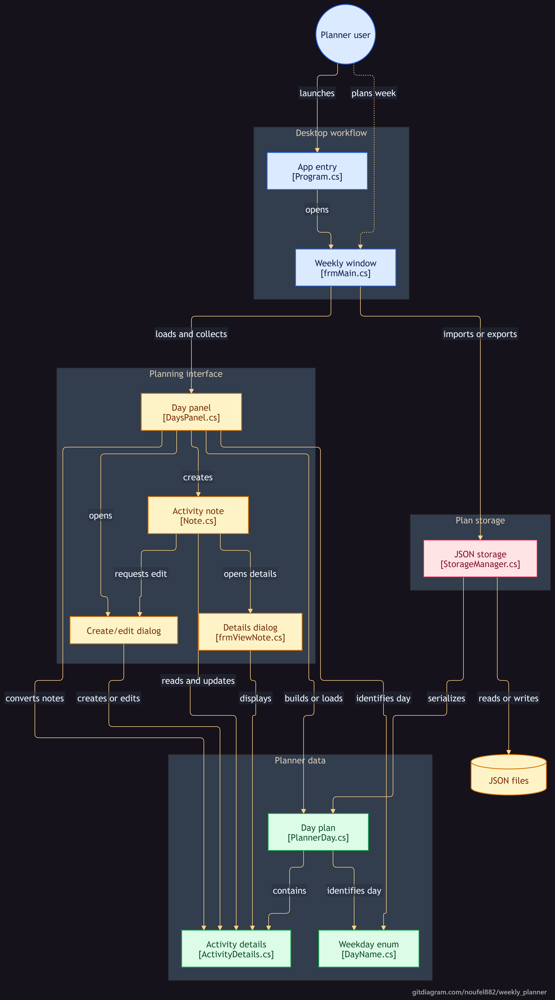

# Weekly Planner

**A lightweight Windows desktop app for organizing activities across your week.**  
**تطبيق سطح مكتب خفيف لنظام Windows لتنظيم أنشطتك على مدار الأسبوع.**



The diagram above shows how the Windows Forms interface, activity and day models, and JSON file storage fit together.

يوضح المخطط أعلاه ترابط واجهة Windows Forms ونماذج الأيام والأنشطة مع تخزين البيانات بصيغة JSON.

## English

### Overview

Weekly Planner is a Windows desktop application built with C# and Windows Forms. It provides a seven-day view for planning activities, tracking their durations, and saving or importing a weekly plan as a JSON file.

### Features

- Organize activities under each day of the week.
- Create activities with a title, description, and duration; edit, view, collapse, or delete them.
- Limit the total planned duration for each day to 24 hours.
- View weekly totals for planned days, activities, and duration.
- Save a plan to a JSON file and import it later.
- Warn about unsaved changes before importing another plan or closing the app.

### Requirements

- Windows
- .NET 10 SDK

### Build and run

Run these commands from the repository root:

```powershell
dotnet build "src/Weekly Planner.slnx"
dotnet run --project "src/Weekly Planner.csproj"
```

Alternatively, open `src/Weekly Planner.slnx` in Visual Studio and run the **Weekly Planner** project.

### Using the app

1. Choose a day and select **إضافة نشاط** (Add activity).
2. Enter the activity title, optional description, and duration.
3. Use the activity controls to view its details, edit it, collapse or expand it, or delete it.
4. Check the weekly summary for the number of planned days and activities and the total duration.
5. Select **حفظ** (Save) to save the plan as JSON. Select **إستيراد** (Import) to load a previously saved JSON plan.

The interface text is currently in Arabic. The Save dialog lets you choose where the JSON plan is stored.

### Project structure

| Path | Purpose |
| --- | --- |
| `src/Program.cs` | Application entry point |
| `src/frmMain.cs` | Main weekly view, summary, and import/save workflow |
| `src/Controls/DaysPanel.cs` | Activities and time tracking for a day |
| `src/Controls/Note.cs` | Activity card and its interactions |
| `src/Forms/` | Activity creation, editing, and details dialogs |
| `src/Models/` | Day names, planner days, activity data, and JSON persistence |
| `resources/appDiagram.png` | Application architecture diagram shown above |

## العربية

### نبذة

Weekly Planner هو تطبيق سطح مكتب لنظام Windows مبني باستخدام C# وWindows Forms. يعرض أيام الأسبوع السبعة لتنظيم الأنشطة ومتابعة مدتها، مع إمكانية حفظ الخطة الأسبوعية أو استيرادها من ملف JSON.

### المزايا

- تنظيم الأنشطة ضمن أيام الأسبوع.
- إنشاء نشاط بعنوان ووصف ومدة، مع إمكانية تعديله أو عرض تفاصيله أو طيه أو حذفه.
- ألا يتجاوز مجموع المدد المخططة لكل يوم 24 ساعة.
- عرض ملخص أسبوعي لعدد الأيام المخطط لها والأنشطة ومجموع المدة.
- حفظ الخطة في ملف JSON واستيرادها لاحقاً.
- التنبيه إلى التعديلات غير المحفوظة قبل استيراد خطة أخرى أو إغلاق التطبيق.

### المتطلبات

- نظام Windows
- حزمة تطوير .NET 10 SDK

### البناء والتشغيل

نفّذ الأوامر التالية من المجلد الرئيسي للمستودع:

```powershell
dotnet build "src/Weekly Planner.slnx"
dotnet run --project "src/Weekly Planner.csproj"
```

أو افتح `src/Weekly Planner.slnx` باستخدام Visual Studio ثم شغّل مشروع **Weekly Planner**.

### طريقة الاستخدام

1. اختر يوماً ثم اضغط **إضافة نشاط**.
2. أدخل عنوان النشاط ووصفه الاختياري ومدته.
3. استخدم أزرار النشاط لعرض التفاصيل أو التعديل أو الطي والتوسيع أو الحذف.
4. راجع الملخص الأسبوعي لمعرفة عدد الأيام والأنشطة المخطط لها ومجموع المدد.
5. اضغط **حفظ** لتخزين الخطة في ملف JSON، أو **إستيراد** لفتح خطة JSON محفوظة مسبقاً.

واجهة التطبيق باللغة العربية حالياً، ويتيح مربع الحفظ اختيار مكان تخزين ملف الخطة.

### بنية المشروع

| المسار | الغرض |
| --- | --- |
| `src/Program.cs` | نقطة بدء التطبيق |
| `src/frmMain.cs` | العرض الأسبوعي والملخص وسير الحفظ والاستيراد |
| `src/Controls/DaysPanel.cs` | أنشطة اليوم ومتابعة مدده |
| `src/Controls/Note.cs` | بطاقة النشاط والتفاعلات المتاحة |
| `src/Forms/` | نوافذ إنشاء النشاط وتعديله وعرض تفاصيله |
| `src/Models/` | أسماء الأيام وبيانات الخطط والأنشطة والتخزين بصيغة JSON |
| `resources/appDiagram.png` | مخطط بنية التطبيق المستخدم أعلاه |
